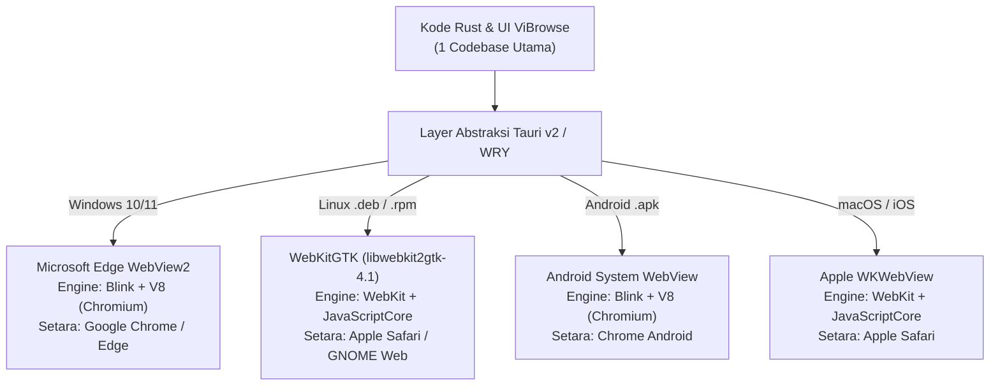

# 04 — Bedah Mendalam Engine WebView (WebView2, WebKitGTK / `libwebkit2gtk`, CEF) & Arsitektur Lintas Platform

Dokumen ini merangkum diskusi arsitektur mendalam mengenai **cara kerja mesin perender web di balik ViBrowse**, mengapa kita memilih **WebView2** di Windows dan **WebKitGTK (`libwebkit2gtk`)** di Linux ketimbang membawa **Chromium mentah (CEF)**, serta bagaimana kesiapan ViBrowse jika dirilis ke **Windows**, **Linux (`.deb` & `.rpm`)**, dan **Android (`.apk`)**.

---

## 1. Peta Mesin WebView di Setiap Sistem Operasi

Tauri v2 (melalui library `wry`) **tidak mem-bundle satu mesin browser raksasa ke semua OS**, melainkan terhubung langsung ke **komponen WebView resmi milik masing-masing Sistem Operasi**:

### Fakta Penting: Apakah di Linux Ada WebView2?
- **Tidak ada.** Meskipun Microsoft merilis aplikasi *browser* Microsoft Edge untuk Linux, Microsoft **tidak pernah merilis komponen *WebView2 Runtime* untuk Linux**. WebView2 menggunakan arsitektur Win32 COM yang eksklusif untuk Windows.
- Oleh karena itu, di Linux, Tauri otomatis beralih menggunakan standar industri WebView di ekosistem Linux/GTK, yaitu **`WebKitGTK`** (nama paket sistemnya: `libwebkit2gtk-4.1-0` di Debian/Ubuntu dan `webkit2gtk4.1` di Fedora/RHEL).

---

## 2. Pertanyaan Kritis: "WebView2 Kan Pakai Chromium, Kenapa Tidak Ambil Chromium Langsung Saja?"

Pertanyaan ini sangat mendasar. Di dunia pengembangan aplikasi desktop, "mengambil Chromium langsung" berarti menyematkan **CEF (*Chromium Embedded Framework*)**—cara yang dipakai oleh Electron, Discord, Spotify Desktop, dan Steam.

Berikut **5 alasan teknis utama** kenapa ViBrowse memilih **OS WebView (WebView2 / WebKitGTK)** dan **bukan Chromium langsung (CEF)**:

### 2.1 Ukuran Aplikasi: `2.45 MB` vs `~150 – 220 MB`
- Aplikasi pihak ketiga **dilarang menumpang** ke dalam folder instalasi Google Chrome milik user (`C:\Program Files\Google\Chrome\...`) karena struktur internal Chrome tidak diekspos sebagai shared SDK publik dan berubah setiap update.
- Jika memakai Chromium langsung (CEF), ViBrowse **wajib mengemas seluruh mesin Chromium sendiri** ke dalam installer:
  - `libcef.dll` (~180 MB)
  - `icudtl.dat` (~10 MB tabel Unicode)
  - Snapshot V8, library GPU ANGLE (`libEGL.dll`, `libGLESv2.dll`), serta `d3dcompiler_47.dll`.
- Dengan **WebView2**, seluruh mesin berat tersebut **sudah terpasang di Windows 10/11 sebagai komponen OS**, sehingga installer ViBrowse cukup membawa logika aplikasi kita sendiri (**2.45 MB**) + `WebView2Loader.dll` (**157 KB**)!

### 2.2 Penghematan RAM Tingkat Kernel (*Shared DLL Memory Pages*)
- Karena WebView2 adalah komponen resmi Windows (dipakai juga oleh Windows Widgets, Office, PowerToys, dll.), halaman memori kode mesin Chromium-nya **dibagi pakai (*shared memory pages*)** oleh kernel Windows di RAM fisik.
- Jika kita mem-bundle Chromium/CEF sendiri, kernel Windows menganggap `libcef.dll` milik kita sebagai file berbeda dan harus memuat salinan 200 MB baru yang terpisah ke dalam RAM.

### 2.3 Update Keamanan Otomatis (*Evergreen Zero-Day Patching*)
- Celah keamanan berbahaya pada engine browser (*V8 type confusion*, *Blink use-after-free*) ditemukan hampir setiap beberapa minggu.
- **Dengan WebView2 & `libwebkit2gtk`**: Microsoft (via *Windows Update*) dan pengelola distro Ubuntu/Fedora (via `apt upgrade` / `dnf upgrade`) **memperbarui mesin browser di belakang layar secara otomatis**. Pengguna ViBrowse otomatis terlindungi dari eksploitasi web terbaru tanpa perlu mengunduh ulang ViBrowse!
- **Jika bawa Chromium/CEF sendiri**: Setiap kali ada celah keamanan Chrome, pembuat aplikasi wajib meng-compile ulang CEF dan memaksa seluruh pengguna mengunduh ulang update 150 MB+.

### 2.4 Dukungan Codec Video Berlisensi (H.264 / MP4 / AAC)
- Kode sumber mentah *open-source* Chromium secara bawaan **tidak mengaktifkan codec berpaten H.264 dan AAC** (yang dipakai oleh mayoritas video `.mp4` dan HLS `.m3u8` di internet, termasuk situs streaming/donghua).
- Agar CEF mendukung H.264/AAC, kita harus mengompilasi Chromium sendiri dari source code dengan flag khusus (membutuhkan **disk >120 GB, RAM 32–64 GB, waktu kompilasi 5–10 jam**, serta urusan lisensi paten MPEG-LA).
- Sebaliknya, **WebView2** di Windows sudah menyertakan dukungan codec media modern secara resmi dan siap pakai!

### 2.5 Kapan Mengambil Chromium Langsung (CEF) Baru Masuk Akal?
Hanya jika:
1. Kamu menuntut **100% mesin Blink/Chromium yang identik di Linux** dan bersedia menerima ukuran `.deb`/`.rpm` membengkak menjadi **~150 MB**.
2. Kamu perlu **memodifikasi kode C++ internal Blink/V8** atau memasang sistem **ekstensi Chrome Web Store (`.crx`) penuh** seperti yang dilakukan perusahaan besar (Brave, Vivaldi, Opera).

---

## 3. Bedah Mendalam `WebKitGTK` / `libwebkit2gtk` di Linux

Saat ViBrowse dikompilasi menjadi paket **`.deb`** (Debian, Ubuntu, Linux Mint, Pop!_OS) dan **`.rpm`** (Fedora, RHEL, openSUSE, Rocky Linux), ia menggunakan **`libwebkit2gtk-4.1`**.

### 3.1 Apa Itu `WebKit`, `libwebkit`, dan `WebKitGTK`?
1. **WebKit**: Mesin perender HTML/CSS *open-source* (awalnya dikembangkan dari KHTML oleh Apple) beserta mesin JavaScript **JavaScriptCore (JSC)**. Ini adalah jantung dari browser **Apple Safari** di macOS & iOS. *(Sebagai catatan sejarah: Google Blink/Chromium sendiri awalnya adalah fork dari WebKit pada tahun 2013).*
2. **WebKitGTK (`libwebkit2gtk-4.1`)**: Porting resmi WebKit ke ekosistem desktop Linux menggunakan toolkit grafis **GTK3/GTK4** dan **libsoup3** (stack HTTP/2 & HTTP/3 modern di Linux). Angka `2` pada `webkit2gtk` menandakan **arsitektur Multi-Process** (proses UI terpisah dari `WebKitWebProcess` dan `WebKitNetworkProcess`, persis seperti isolasi proses modern di Chrome).
3. **Crate Rust `webkit2gtk`**: Binding Rust yang kita gunakan di [src/tabs.rs](../src/tabs.rs) pada blok `#[cfg(target_os = "linux")]` untuk menghubungkan event fullscreen video (`connect_enter_fullscreen` & `connect_leave_fullscreen`) ke jendela utama ViBrowse.

### 3.2 Kelebihan `libwebkit2gtk-4.1` untuk ViBrowse di Linux
- **Ukuran Paket `.deb` & `.rpm` Sangat Kecil (~3 – 5 MB)**: Karena `libwebkit2gtk-4.1` sudah tersedia di repositori resmi semua distro Linux populer dan diinstal sekali saja sebagai *shared library* (`/usr/lib/.../libwebkit2gtk-4.1.so`), file `.deb`/`.rpm` ViBrowse hanya berisi biner Rust kita + icon + desktop entry.
- **Integrasi Native Linux**: Mendukung Wayland maupun X11, menggunakan sertifikat SSL sistem Linux, serta menghormati font rendering FreeType/Fontconfig milik pengguna Linux.
- **Auto Tab Sleeping Tetap Bekerja**: Saat ViBrowse memanggil `webview.close()` pada tab menganggur di Linux, proses `WebKitWebProcess` milik tab tersebut benar-benar dimatikan oleh OS sehingga RAM langsung kembali lega.

### 3.3 Perbedaan & Hal yang Perlu Diperhatikan di Linux (`WebKitGTK`)
1. **Kompatibilitas Web (~92–95% dibanding Chromium)**:
   - Situs populer (Google, YouTube, GitHub, Wikipedia, web app modern) berjalan lancar. Namun sebagian kecil website yang hanya dites oleh pembuatnya di Chrome kadang memiliki perbedaan kecil pada CSS/API spesifik Blink.
2. **Codec Video Linux (`GStreamer`)**:
   - Di Linux, `WebKitGTK` memutar video HTML5 menggunakan pipeline **GStreamer** milik sistem Linux (`gstreamer1.0-plugins-good`, `bad`, `libav`). Mayoritas distro modern seperti Ubuntu Desktop dan Linux Mint sudah menyediakannya.
3. **Driver GPU Nvidia pada Wayland**:
   - Pada sebagian kartu grafis Nvidia di sesi Wayland Linux, renderer DMA-BUF milik WebKitGTK terkadang memicu layar putih/kedip. Solusi standarnya sangat mudah: menjalankan dengan variabel lingkungan `WEBKIT_DISABLE_DMABUF_RENDERER=1`.

---

## 4. Bedah Kesiapan & Arsitektur untuk Android (`.apk`)

Bagaimana jika ViBrowse dibawa ke **Android**?

### 4.1 Kabar Baik: Mesin Android Adalah Chromium!
Berbeda dengan Linux desktop yang memakai WebKitGTK, setiap ponsel Android modern memiliki komponen bawaan bernama **Android System WebView** (yang diperbarui terus lewat Google Play Store) dan **mesin di dalamnya adalah 100% Chromium (Blink + V8)**!
Artinya:
- Ukuran APK bisa tetap **sangat kecil (~8 – 15 MB)**.
- Kompatibilitas situs web, streaming video, dan kecepatan JS **100% setara Chrome Android**.
- Engine Rust kita (`rusqlite`, `adblock`, IDM multi-connection `reqwest`, dan BitTorrent `librqbit`) **bisa dikompilasi langsung ke arsitektur chip HP (`aarch64-linux-android` / ARM64)**.

### 4.2 Empat Penyesuaian yang Diperlukan Saat Membangun Versi Android
Kode desktop tidak bisa langsung dijadikan `.apk` dalam satu klik karena 4 perbedaan fundamental OS mobile:

| Tantangan di Android | Penjelasan Teknis | Solusi Arsitektur untuk ViBrowse Android |
| --- | --- | --- |
| **1. Multi-WebView** | Tauri v2 Mobile hanya menyediakan 1 WebView utama untuk UI, belum mendukung `Window::add_child` seperti di Windows/Linux. | Membuat **Tauri Kotlin Plugin** tipis yang mengelola instance `android.webkit.WebView` per tab, sekaligus memakai `shouldInterceptRequest` untuk Ad-Blocker native Android yang sangat kuat. |
| **2. Antarmuka Layar Sentuh** | Tab strip horizontal & side panel `360px` dirancang untuk mouse & layar lebar desktop. | Menambahkan mode CSS Mobile Responsif: Address bar ramah jempol, *Tab Switcher* berbentuk kartu grid, dan *Bottom Sheet* untuk Downloads/Bookmarks. |
| **3. Pembatasan `yt-dlp` (`SELinux W^X`)** | Android 10+ melarang mengeksekusi file binary yang diunduh ke folder data aplikasi, dan Android tidak memiliki Python bawaan untuk menjalankan `yt-dlp`. | Opsi A (Tetap Ringan <12 MB): Gunakan ekstraktor video murni Rust. Opsi B (Full `yt-dlp`): Gunakan library JNI `youtubedl-android` yang mem-bundle Python + `yt-dlp` (ukuran APK menjadi ~50 MB). |
| **4. Manajemen Baterai & Background** | OS Android agresif mematikan koneksi jaringan/proses saat layar HP mati atau aplikasi berpindah ke belakang. | Membungkus `DownloadManager` & `librqbit` dengan **Android Foreground Service** (notifikasi progress unduhan di bar atas) dan otomatis menghentikan DHT BitTorrent begitu unduhan 100% selesai agar baterai hemat. |

---

## 5. Kesimpulan Akhir Pemilihan Teknologi ViBrowse

| Target OS | Paket Distribusi | Engine yang Dipakai | Apakah Tetap Ringan & Optimal? |
| --- | --- | --- | --- |
| **Windows 10/11** | `Setup.exe` (**2.45 MB**) & `Portable.zip` (**2.91 MB**) di `release/windows/` | **WebView2** (Chromium) + Rust | **Sangat Optimal (10/10)** — Siap pakai di PC lain tanpa install library tambahan. |
| **Linux Desktop** | `.deb` (Ubuntu/Debian) & `.rpm` (Fedora/RHEL) di `release/linux/` | **WebKitGTK** (`libwebkit2gtk-4.1`) + Rust | **Optimal & Ringan (8.5/10)** — Kode lintas platform & builder script sudah siap di repositori. |
| **Android** | `.apk` / `.aab` di `release/android/` | **Android System WebView** (Chromium) + Rust Core + Kotlin Tab Plugin | **Sangat Potensial (9/10 setelah adaptasi UI/Plugin Mobile)** — Berbagi engine Rust (`storage`, `adblock`, `IDM`, `librqbit`) yang sama dengan versi desktop. |
