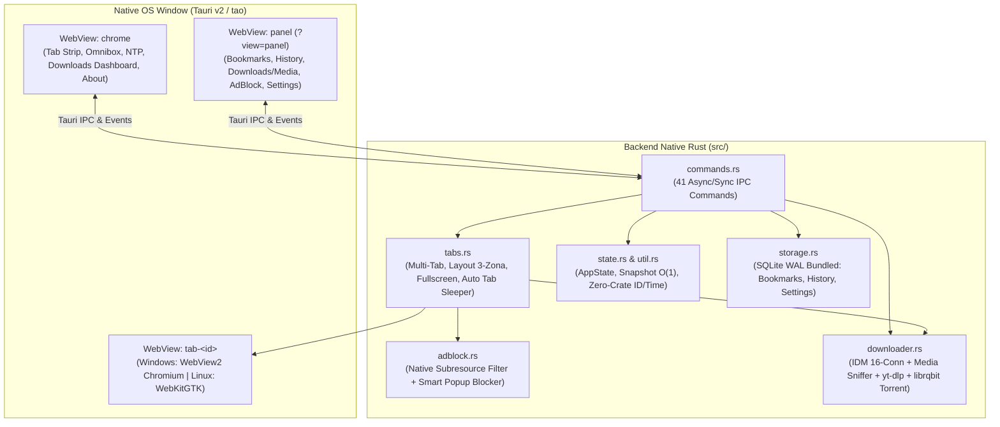

# Dokumentasi Lengkap Proyek ViBrowse (V1.2a)

**ViBrowse V1.2a** adalah web browser modern yang **ultra-ringan (installer Windows hanya ~2.45 MB!), hemat RAM, dan kompatibel situs modern setara Google Chrome**, dibangun menggunakan **Rust + Tauri v2** dengan pemanfaatan native OS WebView (**WebView2** di Windows, **WebKitGTK** di Linux), dilengkapi **Auto Tab Sleeping**, **Native Ad & Smart Popup Blocker**, serta **Download Manager Terpadu (IDM 16-Koneksi + Video/YouTube + Native Rust BitTorrent)**.

---

## Daftar Isi Dokumentasi

| No | Dokumen | Ringkasan Isi |
| --- | --- | --- |
| 1 | [01-arsitektur-dan-tech-stack.md](./01-arsitektur-dan-tech-stack.md) | Arsitektur sistem V1.2a, **alasan mendalam pemilihan setiap library/crate**, kenapa memakai OS WebView dibanding mem-bundle Chromium mentah, layout 3-Zona Disjoint, skema SQLite, serta teknik optimasi ukuran binary. |
| 2 | [02-fitur-dan-implementasi.md](./02-fitur-dan-implementasi.md) | Bedah teknis seluruh fitur V1.2a: Multi-Tab & Tab Sleeping, Ad-Blocker Native + Smart Popup Blocker, **Download Manager (IDM + Media Sniffer + `yt-dlp` + BitTorrent `librqbit`)**, True Fullscreen, Light/Dark SVG UI, `vibrowse://about`, dan 41 Tauri IPC Commands. |
| 3 | [03-panduan-build-dan-pengembangan.md](./03-panduan-build-dan-pengembangan.md) | Panduan build Debug & Release, packaging Windows (`Setup.exe` & `Portable.zip`) dan Linux (`.deb` & `.rpm`), struktur folder `release/`, serta roadmap v2+. |
| 4 | [04-bedah-engine-webview-dan-lintas-platform.md](./04-bedah-engine-webview-dan-lintas-platform.md) | **Bahasan Khusus & Mendalam**: Bedah cara kerja **WebView2 vs Chromium/CEF vs WebKitGTK (`libwebkit2gtk`) vs Android System WebView**, alasan teknis pemilihan library tiap OS, kelebihan/kekurangan, serta arsitektur porting ke Windows, Linux (`.deb`/`.rpm`), dan Android (`.apk`). |
| 5 | **[05-referensi-variabel-dan-fungsi.md](./05-referensi-variabel-dan-fungsi.md)** | **Referensi Developer**: Daftar lengkap konstanta, struct/enum, variabel state, fungsi backend Rust (`src/`), variabel & fungsi frontend (`ui/app.js`), serta payload event IPC. |

---

## Ringkasan Arsitektur Tingkat Tinggi (V1.2a)



---

## Struktur Direktori Proyek

```text
d:\docker\vibrowse\
├── Cargo.toml                  # Konfigurasi crate Rust & profil optimasi ukuran (opt-level="z", fat LTO)
├── .cargo/config.toml          # Linker flags (--gc-sections) untuk Windows & Linux
├── build.rs                    # Build script Tauri + watcher perubahan icon
├── tauri.conf.json             # Konfigurasi aplikasi & bundler (.deb, .rpm, .msi, .exe)
├── Logo.png                    # Aset master logo ViBrowse
├── capabilities/default.json   # Isolasi keamanan IPC khusus webview "chrome" & "panel"
├── icons/                      # Icon multi-resolusi (32x32.png, 128x128.png, icon.ico 19.5 KB)
├── scripts/build-linux.sh      # Builder otomatis paket Linux (.deb & .rpm)
├── .github/workflows/          # Pipeline CI/CD otomatis multi-platform (Windows & Linux)
├── src/
│   ├── main.rs                 # Entry point, window, child webviews, registrasi 41 handler
│   ├── util.rs                 # Helper ringan pengganti uuid & chrono (short_id, now_iso, extract_host)
│   ├── state.rs                # State tab, helper tab()/tab_mut()/tab_label(), snapshot O(1)
│   ├── tabs.rs                 # Engine multi-tab, hook native Windows/Linux, fullscreen, tab sleeper
│   ├── adblock.rs              # Engine Ad-Blocker 2-lapis & Smart Popup Blocker + allowlist per situs
│   ├── downloader.rs           # Engine IDM multi-koneksi, yt-dlp, Media Sniffer & BitTorrent (librqbit)
│   ├── storage.rs              # Persistensi SQLite WAL (bookmarks, history, settings)
│   └── commands.rs             # Seluruh 41 Tauri IPC commands
├── ui/
│   ├── index.html              # Markup UI (Toolbar SVG, NTP, Dashboard IDM/Torrent, About ViBrowse)
│   ├── styles.css              # Tema Dark Mode & Light Mode + styling modern SVG Lucide
│   ├── app.js                  # Logika frontend modular, live listener, Chrome shortcuts
│   └── logo.png                # Logo terkompresi (14.5 KB, 128x128 RGBA)
├── release/                    # Paket distribusi terpisah per OS
│   ├── windows/                # ViBrowse-V1.2a-Setup.exe & ViBrowse-V1.2a-Portable.zip
│   ├── linux/                  # Target output ViBrowse .deb & .rpm
│   └── android/                # Target output ViBrowse .apk
└── dokumen/                    # Dokumentasi teknis lengkap (5 bagian + README)
```
